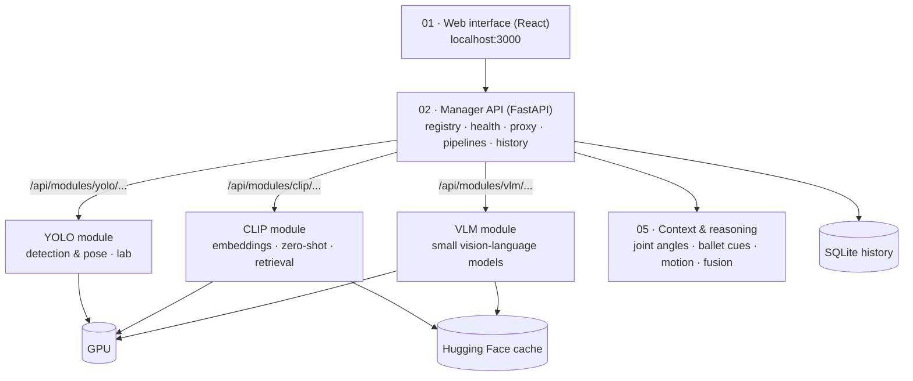

# MultiVision AI Manager

A hub that manages several computer-vision modules, each running in its own Docker
container with its own API and web page. The manager is the master: it registers the
modules, checks their health, forwards the web interface's calls to them and
orchestrates them in pipelines. The first use case is **movement in sport**, starting
with **classical ballet**, on **single pictures or sequences of pictures** (no video yet).



| Layer (from the design) | Implemented as |
| --- | --- |
| 01 User interface | `manager/web` (React + Vite), plus a standalone page in every module (`/ui/`) |
| 02 API & application | `manager/api` (FastAPI): module registry, health, reverse proxy, pipeline, history |
| 03 Image processing | Upload of one picture or an ordered sequence, EXIF orientation, per-model resizing, dancer crops |
| 04 AI perception | YOLO (detection + 17-keypoint pose), CLIP, VLM modules |
| 05 Context & reasoning | `manager/api/app/pose.py` + `pipeline.py`: joint angles, ballet pose cues, motion across frames, a VLM prompt grounded in those measurements, evidence fusion |
| 06 Output & knowledge | Structured results, analysis history with the pictures |
| 07 Data & infrastructure | Docker Compose, a volume per module, shared Hugging Face cache, SQLite (PostgreSQL / vector DB later) |

## Modules

Every module is an independent service that serves `GET /health`, `GET /v1/info`
(name, model, device, capabilities) and its own web page at `/ui/`. Add a module by
implementing those and listing it in `MANAGER_MODULES`.

### YOLO: detection & pose

Lives in its own repository, [detect_image_engine](https://github.com/marcomaggiotti/detect_image_engine)
(the lab is on branch `claude/serene-dirac-srols1` until it is merged).

| Topic | Where to customise it in the UI (YOLO page) |
| --- | --- |
| IoU thresholds, confidence, input size, FP16 | *Inference & thresholds* (applied live) |
| Bounding-box regression, classification / objectness, DFL, pose losses | *Training → Losses* (gains) |
| Class imbalance | *Datasets* (class statistics, suggested weights), *Training → Losses* (focal loss, per-class weights), *Training → Class imbalance* (repeat-factor sampling) |
| Assignment strategies | *Training → Assignment* (Task-Aligned Assigner top-k / alpha / beta; RT-DETR Hungarian matcher costs) |
| Transfer learning, fine-tuning | *Training → Transfer learning* (base model, pretrained vs scratch, frozen layers, optimiser, LR schedule), continue from a previous run |
| Dataset annotation | *Datasets & annotation* (draw boxes, pre-label with the active model, import/export YOLO zip) |
| Augmentation | *Training → Augmentation* (presets incl. `ballet-studio`, every parameter) |
| Custom YOLO detector | *Models*: serve pretrained, fine-tuned (`job:<id>`) or exported weights |
| Robustness | *Robustness*: 11 perturbations × severity, share of detections kept |
| Latency optimisation | *Latency*: benchmark per input size and FP32/FP16; export to ONNX / TensorRT / OpenVINO |

### CLIP (`modules/clip`)

| Topic | Where |
| --- | --- |
| Dual encoders, image and text representations | *Model*: both towers (patch size, tokens, layers, parameters), CLIP and SigLIP checkpoints |
| Embedding spaces | *Embedding space*: 2-D PCA map of pictures and texts, modality-gap metrics |
| Contrastive learning, temperature scaling, cosine similarity | *Similarity*: cosine matrix and softmax in both directions with an adjustable temperature |
| Zero-shot classification | *Zero-shot & prompts*: ballet steps/positions, prompt ensembles, softmax vs sigmoid |
| Prompt sensitivity | Per-template probabilities and agreement; dataset-level accuracy per template; tokenizer view |
| Semantic retrieval | *Retrieval*: galleries, search by text or by picture |
| Linear probing | *Fine-tuning*: probe on frozen embeddings, compared with zero-shot, confusion matrix |
| Fine-tuning, hard negatives, domain adaptation | *Fine-tuning*: contrastive training with layer-unfreezing strategies, fixed or learnable temperature, hard-negative weighting (β) |

### VLM (`modules/vlm`)

| Topic | Where |
| --- | --- |
| Different VLMs, smaller first | *Models*: SmolVLM-256M (~1 GB) → SmolVLM-500M → LLaVA-OneVision-0.5B → InternVL3-1B → Qwen2-VL-2B → SmolVLM2-2.2B → Qwen2.5-VL-3B, any other Hugging Face id; 8/4-bit loading |
| Image encoders, cross-attention, multimodal alignment | *Models → Architecture*: image encoder → connector → language model, fusion type, parameter split |
| Tokenization | *Tokens & attention*: the templated prompt, image tokens per tile, special tokens |
| Attention | *Tokens & attention*: attention mass on image / prompt / answer per layer, layers × heads, heat map on the picture |
| Decoding | *Ask* (all parameters, per-token probabilities and alternatives), *Decoding comparison* (greedy / beam / sampling side by side) |
| Instruction tuning | *Instruction data* + *Instruction tuning*: LoRA / QLoRA, loss on the response only, optional connector training |
| Evaluation | *Evaluation*: exact match, contains, token F1, ROUGE-L, ballet-vocabulary recall, latency |

## Ballet analysis pipeline

*Ballet analysis* page, or `POST /api/analyze` with one or more pictures (in order):

1. **YOLO pose** finds the dancer (largest person) and 17 keypoints.
2. **Pose geometry** measures knee and elbow angles, leg and arm elevation, leg spread and
   torso tilt, and derives cues (e.g. *right leg extended behind at 95°, straight →
   arabesque*; *foot at the standing knee → passé / pirouette*). For a sequence it adds
   per-frame curves, joint motion and the peak leg elevation.
3. **CLIP** ranks ballet steps on the dancer's crop (plain-English descriptions of the
   French terms help).
4. **VLM** answers the question with the pictures *and* the measurements in its prompt.
5. **Fusion** ranks candidate steps with the evidence from each source.

The angles are 2-D, as seen by the camera, so the cues are hints, not measurements.

## Run it

Requirements: Docker with Compose v2.24+. For the GPU: an NVIDIA driver and the
[NVIDIA Container Toolkit](https://docs.nvidia.com/datacenter/cloud-native/container-toolkit/).

```bash
git clone https://github.com/marcomaggiotti/MultiVisionAIManager
git clone -b claude/serene-dirac-srols1 https://github.com/marcomaggiotti/detect_image_engine
cd MultiVisionAIManager
cp .env.example .env
docker compose up --build
```

Open http://localhost:3000. The modules are also reachable directly:
YOLO http://localhost:8001/ui/, CLIP http://localhost:8002/ui/, VLM http://localhost:8003/ui/
(each with `/docs`). The first start downloads the models (YOLO weights are baked into the
image; CLIP and VLM go to the shared `hf-cache` volume).

No NVIDIA GPU:

```bash
docker compose -f docker-compose.yml -f docker-compose.cpu.yml up --build
```

**GPU memory.** YOLO11n-pose (~0.3 GB), CLIP ViT-B/16 in fp16 (~0.3 GB) and SmolVLM-256M
(~1 GB) fit together on a 4 GB GPU. For 2-3B VLMs use `VLM_QUANTIZATION=4bit`, and unload
the VLM (*VLM → Models → Unload*) before long YOLO or CLIP training on small GPUs.

### Development without Docker

```bash
# modules (each in its own terminal)
cd ../detect_image_engine && pip install -e ".[ultralytics,dev]" && \
  DETECT_MODEL_WEIGHTS=yolo11n-pose.pt DETECT_TARGET_CLASSES=person uvicorn app.main:app --port 8001
cd modules/clip && pip install -e ".[dev]" && uvicorn app.main:app --port 8002
cd modules/vlm && pip install -e ".[dev]" && uvicorn app.main:app --port 8003
# manager
cd manager/api && pip install -e ".[dev]" && uvicorn app.main:app --port 8080
cd manager/web && npm install && npm run dev      # http://localhost:5173
```

Tests: `pytest` in `manager/api`, `modules/clip`, `modules/vlm` and `detect_image_engine`.
The CLIP and VLM suites build tiny random models offline, so they exercise the real
`transformers` / `peft` code paths without downloads.

## Repository layout

```
docker-compose.yml          GPU stack            docker-compose.cpu.yml   CPU override
manager/api/                hub: app/main.py (registry, proxy, routes), pipeline.py, pose.py, storage.py
manager/web/                React app: pages/ (Dashboard, Analyze, YoloStudio, ClipStudio, VlmStudio)
modules/clip/               CLIP module: engine.py, analysis.py, gallery.py, training.py, static/ (own page)
modules/vlm/                VLM module: engine.py, training.py (LoRA, evaluation), metrics.py, static/
../detect_image_engine/     YOLO module (separate repository)
```

## Next steps

- Video: frame sampling and a frame scheduler in the image-processing layer, tracking
  between frames.
- Knowledge layer: PostgreSQL for results, a vector database for CLIP embeddings, RAG
  over a ballet syllabus for the reasoning layer.
- Authentication and job queues (Redis) when more than one person uses it.
- Keypoint annotation in the YOLO annotator (today pose labels come from pre-labelling).
