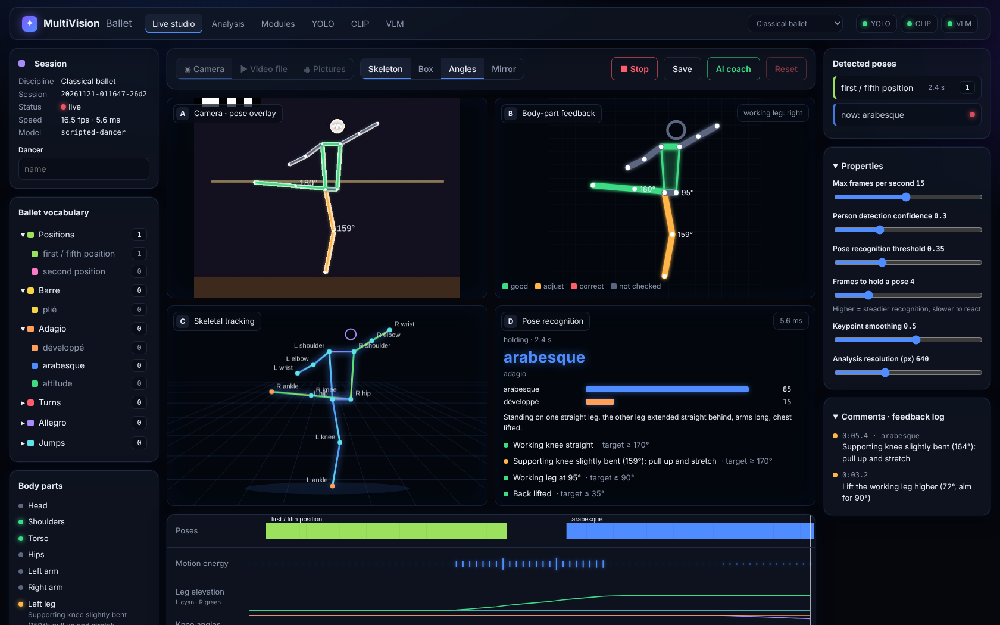
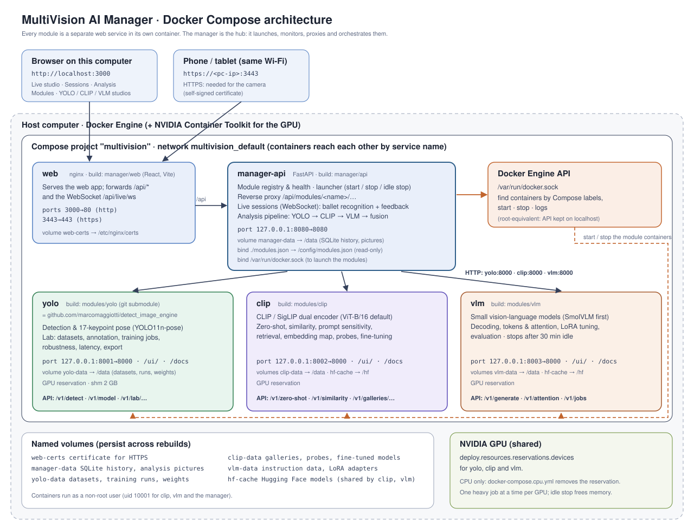

# MultiVision AI Manager

A hub that manages several computer-vision modules. **Every module is a separate web
service** (its own container, API and web page). The manager is the master: it
**launches and stops the modules** (from the dashboard, or automatically when a pipeline
or the web interface needs one), checks their health, forwards the web interface's calls
to them and **triggers** them in pipelines. The first use case is **movement in sport**, starting
with **classical ballet**, on **single pictures or sequences of pictures** (no video yet).



## Live studio: real-time ballet feedback

The home page of the web interface. **Choose a video** from the library list (videos are
added in the Library tab), click **◉ Camera**, or pick **▦ Pictures**: every frame goes to
YOLO pose through the manager, and within milliseconds the studio shows:

| Panel | What it shows |
| --- | --- |
| **A · Camera** | The analysed picture with the skeleton, each limb coloured by its correction (optional box, knee angles, mirror view) |
| **B · Body-part feedback** | The dancer's own skeleton as a map: green = good, amber = adjust, red = correct, with the key angles |
| **C · Skeletal tracking** | The 17 tracked joints, named, on a perspective floor |
| **D · Pose recognition** | The ballet pose being held and for how long, this frame's candidates, the pose's description and targets, and every correction with its target |
| **Timeline** | Held poses, motion energy, leg elevation and knee angles over the session; click or replay to review any moment |
| **Left** | Session, the ballet vocabulary with how many times each pose was performed, body-part status |
| **Right** | Detected poses (count and time held), properties (frame rate, thresholds, frames to hold a pose, smoothing, resolution), the feedback log |

**Recognised poses** (rules on joint angles, `manager/api/app/ballet/recognition.py`): arabesque,
attitude, développé, grand battement, passé, grand jeté, plié (demi / grand), second
position, first / fifth position. When none fits, the studio says so (a transition).

**Feedback per body part**, against the pose's targets: working and supporting knee
straight (≥ 170°), working-leg height (90° arabesque, 110° grand battement), attitude
knee 90-130°, split ≥ 160° in grand jeté, even knees in plié, torso vertical, back lifted
in arabesque, shoulders and hips level, the whole body in the picture. Corrections that
persist are written to the feedback log, with the time, so you can jump back to them.

- Keypoints are smoothed and a pose must hold for a few frames before it is recognised and
  counted (both adjustable), so the feedback does not flicker.
- Frames go over a WebSocket (`/api/live/ws`); the next one leaves when the previous answer
  arrives, so the frame rate follows the GPU (15+ fps with YOLO11n-pose).
- **Library videos are analysed by the manager, not in the studio.** When a video is added
  to the library, the manager analyses every frame in the background (YOLO pose → main
  dancer → smoothing → ballet rules → movements and corrections, in video time; 15 frames
  per second, at most 1500 frames). The Library shows the progress and waits for it. The
  studio then only **plays** the stored analysis (choose the video in the toolbar list:
  analysed videos have a ✓), and the status line links to the same frames in *Analysis*.
  Keypoints corrected in the studio or in Analysis are saved at once and replace the frame
  in the stored analysis and in the keypoint track. **📷 Snapshot** (S) keeps the frame in
  the snapshot library and opens it in *Analysis → Video keypoints*
  (`/analysis?video=<id>&t=<seconds>`). The camera runs in real time until *■ Stop*, which
  saves its session; pictures are analysed in the studio and saved. There is no Save
  button: everything is saved by itself.
- **AI coach** sends the shown frame through the full pipeline (CLIP + VLM) for a
  teacher-style comment. Each session (counts, events, comments, angle series) is saved
  in the manager by itself.
- **🎬 Preview** (library videos, e.g. the reference video; the button after *Snapshot*,
  *Adjust keypoints*, *Note*): the real video in a large window with the skeleton drawn over
  it; each limb lights up in its colour while YOLO's keypoints show it moving (left / right
  arm and leg, head, torso, whole body). Limbs are measured relative to the body (arms and
  head to the shoulders, legs to the hips), in torso lengths per second, from smoothed
  keypoints, so a dancer crossing the floor or YOLO's jitter does not count as a limb moving
  ([`limb_motion.py`](manager/api/app/ballet/limb_motion.py)). A **caption at the bottom of
  the video announces each movement 2 s before it starts** (adjustable) and stays until it
  ends, **shown like karaoke**: a two-line opaque band whose words light up one after the
  other until the movement ends, long captions scrolling up so the current word stays in view
  ([`Karaoke.tsx`](manager/web/src/live/Karaoke.tsx) in the preview, `draw_karaoke` in
  [`annotated_video.py`](manager/api/app/media/annotated_video.py) in the export, same timing).
  The captions are proposed from the movements found (limbs moving together form one)
  and can be **rewritten or removed**: the edited track is saved with the video
  (*↺ Propose again* forgets the edits). Each caption has **tags** (the limbs it is about)
  that can be removed (✕) and added (＋ tag); a text never rewritten follows its tags. The
  first time a video's captions are proposed, the preview **asks which tags are allowed**
  (with how many movements YOLO found for each): the captions are made of those only, only
  they light up, and the choice is saved with the track (`allowed_limbs`; *🏷 Tags* changes
  it; `GET /api/videos/{id}/captions?allowed=…&fresh=true` proposes with it). Click a caption to play it from the same time before;
  *Play every movement* chains them; one lane per limb shows when it moves.
  **⛶ Full screen** (or a double-click) shows the whole preview, captions and drawings
  included (the video's own full screen, which would show the bare video, is turned off).
  **🐱 Cat** replaces the skeleton with a cartoon cat drawn on the keypoints (striped tabby,
  paws, head with ears, blinking eyes and whiskers, a tail swaying faster while the dancer
  moves; moving limbs glow in their colour); *hide the dancer* blurs her out behind it. The
  cat **stays on the keypoints**: YOLO's jitter is removed with a centred average over the
  frames around (no lag, as the whole video is known), keypoints missed for under 0.5 s are
  filled in, and the preview follows the video between two analysed frames. It **looks
  round**: limbs are shaded tubes, head and paws shaded spheres lit from the top left, a
  shadow lies on the floor, the limbs of the far side (the ear YOLO sees less) are darker and
  behind the body, and the face turns with the head ([`cat.ts`](manager/web/src/live/cat.ts) in the preview,
  [`cat.py`](manager/api/app/media/cat.py) in the export).
  **⬇ Export to the library** makes an MP4 of the analysed pictures with the skeleton, the
  moving limbs, the captions and the video's sound (`<name>-annotated.mp4`, not analysed
  again). API: `GET /api/videos/{id}/limb-movements`, `GET/PUT/DELETE /api/videos/{id}/captions`,
  `POST /api/videos/{id}/annotated-video` → `GET /api/render-jobs/{id}`.
- **Notes on frames** (library videos, e.g. a full class recorded with the teacher's
  explanations): 📝 *Note* (or **N**) writes a note on the shown frame; the *Notes* panel
  shows the frame's note and every note in time order (click to go there), the timeline
  marks them (▾), and *Analysis → Video keypoints* shows and edits them too.
  API: `GET/PUT /api/videos/{id}/notes` (an empty text removes a note).
- **Timeline**: press on a track and slide to move through the video (the panels follow).
  The time (m:ss.cc) and the frame number can be typed to go to an exact frame; coming back to
  the studio reloads the video's analysis, so keypoints corrected in Analysis show here too
  (Analysis' *▶ Live studio* opens the same frame).
- **Player** under the timeline: play / pause, first / last frame, one frame back or
  forward, −3/−2/−1 s and +1/+2/+3 s, replay speed ×0.25 to ×2. While the camera or a video
  runs, Pause freezes the capture (a video file pauses too) so the moment can be inspected.
  Keyboard: `Space` play/pause · `←`/`→` 1 s (`Shift` 3 s) · `,`/`.` one frame ·
  `Home`/`End` · `S` snapshot · `E` adjust keypoints.
- **Adjust keypoints** (✎ or `E`) when the model misplaces a joint: pause, drag the points
  to where the joints really are (zoom with the wheel, arrow keys nudge the selected point,
  hide a point the model invented), save. The pose is re-evaluated at once, and the
  adjustment is stored for that moment of that video (file name + size, time in the
  video; a picture is one moment). Every later analysis of the same video uses the saved
  keypoints at that moment (orange marks on the timeline; panel A shows "✎ adjusted"), so
  recognition, counts and corrections follow your fix. In **YOLO · detection & pose**
  (Inference tab), **✎ Adjust keypoints** edits the selected person right in the result
  view (drag, or type x / y), and **✎ Place keypoints by hand** starts from a standing
  figure when the model found nobody; saved for that picture, or for that moment of the
  video when the picture is a snapshot. API: `GET/PUT/DELETE /api/keypoint-adjustments`,
  `POST /api/ballet/evaluate` (evaluate any 17 keypoints).
- **✂ Cut video** (when a video file is chosen): pick the part to keep (start / end at the
  player position, frame by frame, preview), and the manager makes a new file with ffmpeg:
  *exact* (MP4 H.264, re-encoded, plays everywhere) or *fast* (no re-encoding, starts at a
  keyframe). Download it, or analyse it in the live studio right away. Keypoint
  adjustments inside the kept part are carried over to the new file. API:
  `POST /api/videos/cut` (multipart `video`, `start`, `end`, `mode`, `name`, `media_key`).
- The live session belongs to the app, not to the page: open the YOLO, CLIP or VLM tab
  while a video runs (a red dot next to *Live studio* shows it is still running) and come
  back to the same video, frames and player position.
- **Keypoints**: the right panel lists the shown frame's 17 keypoints in real time (pixels,
  visibility; hover rings the point in panel A, click follows it); *Keypoints per frame*
  under the timeline collects every analysed frame: a trajectory chart of the followed
  keypoint, a frame table (click to go there), CSV (one row per frame and keypoint) and
  JSON download. Saved sessions include the keypoints of each frame.
- **Panels A-D**: each panel's title is a chooser: camera, body-part feedback, skeletal
  tracking, pose recognition, key positions, joint angles, or a chart of the last 10 s
  (motion energy, leg elevation, knee angles, arm elevation) following the shown frame.
- **Video keypoints** (saved with the session): each analysed frame's keypoints are stored with the library
  video at its time in the video (a new analysis replaces the part it covers). *Analysis →
  Video keypoints*: pick a video and a time range; every saved frame appears (thumbnail with
  skeleton, from `/api/videos/{id}/frame?t=`); click one (← / →) for the large frame and its
  17 keypoints, plus a trajectory chart and CSV of the range. *☰ Table* lists the frames as
  lines (small picture, time, movement) and keypoints 0–16 as columns (x, y). **✎ Adjust keypoints** on the
  selected frame replaces its keypoints (and keeps the fix as a keypoint adjustment for later analyses). API: `PUT /api/keypoint-tracks`,
  `GET/DELETE /api/videos/{id}/keypoints?start&end`.
- **Snapshot library**: every snapshot is saved in the manager (the clean frame, with its
  video, time, recognised movement and corrections): *Library → 📷 Snapshots* to view,
  annotate, download, delete or open one in YOLO, CLIP or the VLM; those tabs (and the VLM /
  Admin *Pictures* input) choose from it with **📷 From snapshots**. API:
  `GET/POST /api/snapshots`, `GET/PATCH/DELETE /api/snapshots/{id}`, `/image`.
- **Snapshot** (📷 or `S`) of the shown frame, with or without the pose overlay: download,
  share (phone share sheet, or copy to the clipboard), open it in **YOLO · detect**,
  **CLIP · zero-shot** or **VLM · ask** (the question is pre-filled with the recognised
  movement and the corrections of that moment), or add the clean picture to a **YOLO
  dataset** (to annotate and train) or a **CLIP gallery** labelled with the movement.
- **Sessions** tab: every saved session (search by title or pose), with poses performed and
  time held, the most frequent corrections, the held-pose timeline, angle and motion charts
  and the feedback log; rename, download as JSON or delete. Sessions are stored in the
  manager's SQLite database (`manager.sqlite3` in the `manager-data` volume); API:
  `GET/PATCH/DELETE /api/live/sessions[/<id>]`.
- Angles are measured in the picture (2-D): film from the side for arabesque, attitude
  and jumps, from the front for positions and plié.

## Compare: dance along with a reference video

**Library videos** (first tab): tick the **reference** (the instruction video to follow,
by default the oldest) and one or more **performances** among the analysed library
videos. The **newest performance** is shown, frame by frame, with the skeletons of every
other video over it: the reference thick in gold, earlier performances thinner, the
dancer's own in green. Each skeleton is aligned on the shown dancer's torso (moved and
scaled), so different framings compare; an **offset** per video lines up the starts. Each
performance gets a match score with the reference at every frame (joint angles, left /
right mirroring detected), its average, and a score chart (click to go there).
**🎬 Make the comparison video** draws all this on every frame and encodes an MP4, saved in
the Library (`comparison-<performance>-vs-<reference>.mp4`).
Code: `manager/api/app/media/video_comparison.py`; API: `POST /api/video-comparisons/preview`,
`POST /api/video-comparisons/render` → `GET /api/video-comparisons/jobs/{id}`.

**🎵 Sound** (in *Library videos*, for any of the compared videos, the reference by default:
the teacher's explanations) extracts the video's audio (FLAC) and cleans it with
the **audio module**, [audio_clean_service](https://github.com/marcomaggiotti/audio_clean_service)
(`modules/audio`, git submodule): it measures the recording (noise floor, signal / noise,
loudness, clipping, clicks, mains hum, rumble, consonants), its agent (rule-based, or
Claude with `ANTHROPIC_API_KEY`) tries plans on a preview and keeps the best for the goal
(speech, listening, archive), and ffmpeg filters the whole file (de-clip, de-click,
de-hum, high-pass, noise reduction, loudness). Or choose the filters yourself (*🎚
Filters*). Pauses are **never shortened** (when the agent's plan shortens them it runs
again without that step), so *🔊 Original* / *✨ Cleaned* play **in time with the comparison** (with that video's
offset).
The report shows the plan, the agent's reasons, the measurements before / after and the
spectrograms. The audio is kept in the picture store (`audio/<video id>/`). API:
`GET /api/videos/{id}/audio`, `POST …/audio/extract`, `POST …/audio/clean`,
`GET …/audio/original.flac | cleaned.flac`, `GET …/audio/spectrogram`.

**Live** (second tab):

The **Compare** tab puts the student (left) next to a reference video (right: the
teacher, or any dancer to copy) and compares the two in real time. The student is either
the **camera** (dance along) or a **video** of the student (compare two recordings).

- **Two videos play in sync**: one round play/pause button, one seek bar and one speed
  (0.25x, 0.5x, 1x, 1.5x, 1.75x) drive both; *Your video starts at* shifts the student's
  video (in seconds) to line up the two starts. Each picture pair is analysed while they
  play, so the slower the speed, the more poses are compared.

- **Both dancers are tracked at once**: every tick, the reference video's picture and the
  camera's picture go to the manager in one WebSocket message (`/api/compare/ws`), YOLO
  pose finds the 17 body landmarks of each (the two requests run in parallel), and each
  side gets its own keypoint smoothing.
- **Joint angles are compared**: knees, elbows, leg and arm elevation, torso tilt and leg
  spread. A joint is **green** within 15° of the reference, **yellow** within 30°, **red**
  beyond (both adjustable). The skeleton over each video is drawn in those colours, body
  part by body part, with a correction for each wrong part ("Lift the right leg higher (you
  70°, reference 95°)") and a table of every angle.
- **Live match score**: each joint scores 100 % within the green band, falling to 0 at
  twice the yellow one; the match is their weighted mean (legs count most), smoothed for
  display, with the average, the share of time "in step" (≥ 80 %) and a score timeline.
  When the reference ends (or on Stop) a summary lists the body parts most often red.
- **Mirror**: a student facing the video copies it like a mirror (their left arm copies
  the reference's right). *Auto* pairs the sides that match best; *Mirror* and *Same side*
  force a pairing.
- **Delay**: a student follows a little late, so each pose is compared with the reference
  poses of the last 0.6 s (adjustable) and the best match is kept; the delay is shown.
- With the camera, a 3-2-1 countdown leaves time to get in position; slow speeds help to
  practise, and Restart goes back to the start of both. Keypoint adjustments saved for the reference video
  are used for it too.
- Film the student from the same side as the reference: angles are 2-D.

Code: `app/ballet/comparison.py` (the rules), `app/live/comparison.py` (the session:
two trackers, delay matching, statistics), `app/api/compare.py` (WebSocket), and
`web/src/pages/Compare.tsx` with `web/src/compare/`.

## Video library

The **Library** tab keeps videos in the manager (`<data>/videos/`, records in SQLite), so
they are uploaded once and chosen anywhere:

- **Add** videos (button or drag and drop, several at once, with a progress bar); each is
  checked with `ffprobe` (duration, size), gets a thumbnail and is **analysed** by the
  manager: the progress shows at the top right of every page (⏳ *Analysing … %*, then
  *✓ analysed · open ▶*, which opens it in the live studio); each card shows its state,
  *↻* analyses it again.
  Code: `manager/api/app/media/video_analysis.py` (`VideoAnalyses`: queue, one video at a
  time, resumed after a restart); the result and the analysed pictures go to the
  **picture store** (below), plus the keypoint track and a session. API:
  `GET/POST /api/videos/{id}/analysis`, `GET /api/videos/{id}/analysis/frames/{n}.jpg`;
  `MANAGER_ANALYSE_VIDEOS=false` turns it off.
- **Watch**, **rename**, add **notes** (dancer, class, what to look at), **download**,
  **delete**, **search** names and notes.
- **✂ Cut** a part into a new library video (it remembers which video it was cut from);
  the cut dialog of the live studio can also keep its result in the library.
- **Open** a video in the **Live studio** (its only video source: the studio's list of library videos; it is analysed and saved at once), as the reference of **Compare**, or in the
  **VLM**; the 📚 buttons of the live studio and Compare choose from the library too
  (library videos stream, with seeking, from the manager).
- Keypoint adjustments follow a video (same name and size) and its cuts.

API: `GET/POST /api/videos`, `GET/PATCH/DELETE /api/videos/{id}`, `/file` (byte ranges),
`/thumbnail`, `/frames?start&end&count` (evenly spread pictures), `POST /api/videos/{id}/cut`.

## History of module use

The **History** tab lists every call made through the manager to YOLO, CLIP and the VLM:
from their tabs, Analysis, the VLM tools, AI workflows and agents (the live studio's
per-frame calls are not listed: they are kept in its sessions).

- Each call keeps its time, module, action, **source** (YOLO tab, Analysis, Workflow,
  Agent…), status, latency, a short **summary** (e.g. *1 detection(s): person ×1*, the top
  CLIP label, the start of the VLM answer), the settings sent, the answer (shortened) and
  a thumbnail of the picture.
- Statistics per module (calls, errors, average time) and per source; filter by module,
  source, period and text.
- Open a call to see the picture with its detections, the prompt and the answer, and
  **use the picture again** in YOLO, CLIP or the VLM.
- The newest 5000 calls are kept (`<data>/history/`, records in SQLite).

API: `GET /api/history?module&source&q&hours&limit&offset`, `GET /api/history/stats`,
`GET/DELETE /api/history/{id}`, `/picture`, `DELETE /api/history?module=`.

### Picture store: a database now, Azure later

The pictures of the analysed frames and the analyses are kept in a **picture store**, a
key → bytes store (`frames/<video id>/<run>/<n>.jpg`, `analyses/<video id>.json`) with two
interchangeable implementations ([`picture_store.py`](manager/api/app/media/picture_store.py)):

| `MANAGER_PICTURE_STORE` | Where | Notes |
| --- | --- | --- |
| `database` (default) | SQLite table `pictures` in `<data>/pictures.sqlite3` (WAL), in the `manager-data` volume | one row per picture, the JPEG in a BLOB column |
| `azure` | an **Azure Blob Storage** container (key = blob name, content type kept) | `MANAGER_PIP_EXTRAS=azure` (installs `azure-storage-blob`), `MANAGER_AZURE_STORAGE_CONNECTION_STRING`, `MANAGER_AZURE_STORAGE_CONTAINER` |

Each analysis writes its pictures under a new `<run>`, switches the stored result to it,
then deletes the previous run, so a picture URL never changes content (the browser caches
it). Analyses saved as files by earlier versions move into the store at start.

Moving to Azure later (nothing else changes):

```bash
# .env: MANAGER_PIP_EXTRAS=azure and MANAGER_AZURE_STORAGE_CONNECTION_STRING=<connection string>
docker compose up -d --build manager-api
docker compose exec manager-api python -m app.media.picture_store migrate --to azure
# .env: MANAGER_PICTURE_STORE=azure, then
docker compose up -d manager-api
```

`python -m app.media.picture_store info` tells what the configured store holds.

## Admin: AI workflow builder and LangChain agents

The **Admin** tab builds AI workflows across all the modules, graphically, and runs them
with **LangGraph**; its **agents** are **LangChain** agents that choose the manager's
abilities as tools.

```
Admin builder (React)          manager (FastAPI)
  graph of nodes  ──JSON──▶  FlowGraph ── compile ──▶ LangGraph StateGraph
                                              │  node        = catalog executor
                                              │  arrows      = conditional edges
                                              │  Ask the user = interrupt() + checkpointer (resume)
                                              ▼
            ┌─────────────── executors ───────────────┐
            │ YOLO pose · ballet rules · CLIP · VLM   │
            │ Agent node ─▶ LangChain agent            │
            │   model: VlmChatModel (local) | cloud    │
            │   tools: 7 StructuredTools               │
            └──────────────────────────────────────────┘
                 │ HTTP                     ▲
                 ▼                          │
         YOLO · CLIP · VLM modules (Docker services)
```

- **AI workflow builder**: a palette by category (*Input*, *Vision*: YOLO pose, ballet
  evaluation, CLIP classification; *Language*: ask the VLM; *Agents*: LangChain agent;
  *Logic*: compose text, decision, ask the user; *Output*: end). The node types come from
  the manager's **catalog** (`GET /api/flows/catalog`): each declares its fields, and the
  inspector draws its form from them (texts with variables, sliders, frame choice, saved
  prompts, the agent's model and tools…). Arrows carry conditions (yes / no / contains /
  number > … / otherwise) tried in order; any node can branch, loops are allowed. Check,
  save, save as, export / import JSON; template *Ballet coach*: YOLO checks a dancer is
  there → ballet rules and CLIP name the movement → you choose the depth → an agent
  writes the coaching. **Different VLMs and prompts**: each *Ask the VLM* node has its own
  *VLM model* (the loaded one, one of the VLM module's catalogue, or any model id; the
  manager loads it with `PUT /v1/model` just before the node asks and keeps it for the
  next node) and its own prompt; the *Language* group of the palette lists the saved
  prompts (one click adds a node using it) and *＋ New prompt* writes and saves one
  without leaving the builder. *Run* shows the run live (current node, path taken, each node's
  readings, the agent's thoughts and tool calls) and waits for your answers.
- **How LangGraph runs it** (`app/flows/engine.py`): each flow is compiled to a
  `StateGraph` (state: the variables, the text the arrows test); a node calls its catalog
  executor; its arrows become one conditional edge whose router tries the conditions;
  *Ask the user* calls `interrupt()`, the run waits, and the answer resumes it with
  `Command(resume=…)` from the `InMemorySaver` checkpoint; `recursion_limit` stops endless
  loops. The VLM tab's workflows run on the same engine.
- **Agents (LangChain)** (`app/agents/`): the manager's abilities are `StructuredTool`s
  bound to the run's frames: `frames_overview`, `detect_pose` (YOLO), `evaluate_ballet_pose`
  (YOLO + ballet rules), `classify_movement` (CLIP), `look_at_frames` (VLM),
  `ballet_movement_info`, `search_video_library`. The model is the **local VLM module**,
  wrapped as a LangChain `BaseChatModel` (`VlmChatModel`: no key, nothing leaves the
  machine), driven with the **ReAct** protocol (Thought → Action → Observation → Final
  Answer) since small models do not call tools natively; or a **cloud model** with native
  tool calling (`bind_tools`): set `MANAGER_AGENT_MODELS=anthropic:<model>,openai:<model>`,
  install `pip install .[providers]` and set the API key. The *Agents* tab tries an agent on
  a video part and shows its full trace; the *Agent* node does the same inside a workflow
  and sees the earlier nodes' results.

API: `GET /api/flows/catalog`, `GET/POST/PUT/DELETE /api/flows`, `POST /api/flows/check`,
`POST /api/flow-runs` (+ `GET /{id}`, `POST /{id}/answer`, `POST /{id}/stop`; the VLM tab's
`/api/workflow-runs` are the same runs), `POST /api/agents/run`.

## Architecture



*(Source: [`docs/images/architecture.svg`](docs/images/architecture.svg); PNG version:
[`docs/images/architecture.png`](docs/images/architecture.png).)*

### Containers

`docker compose up -d --build` creates one Compose project, **`multivision`**, with five
containers on one network (`multivision_default`), where they reach each other by service
name (`http://yolo:8000`, ...).

| Service | Image built from | Role | Ports on the host | Storage |
| --- | --- | --- | --- | --- |
| `web` | `manager/web` (React + Vite, served by nginx) | The web interface; forwards `/api/*` and the WebSocket to the manager | `3000` (http), `3443` (https, phones) | `web-certs` (self-signed certificate) |
| `manager-api` | `manager/api` (FastAPI) | The hub: module registry, launching, reverse proxy, live sessions, analysis pipeline, history | `127.0.0.1:8080` | `manager-data` (SQLite, pictures), `modules.json` (read-only), Docker socket |
| `yolo` | `modules/yolo` = [detect_image_engine](https://github.com/marcomaggiotti/detect_image_engine) (git submodule) | Detection and 17-keypoint pose; datasets, training, robustness, latency | `127.0.0.1:8001` | `yolo-data` |
| `clip` | `modules/clip` = [visual-semantic-engine](https://github.com/marcomaggiotti/visual-semantic-engine) (git submodule) | CLIP / SigLIP embeddings, zero-shot, retrieval, fine-tuning | `127.0.0.1:8002` | `clip-data`, `hf-cache` |
| `vlm` | `modules/vlm` = [vlm_hub_engine](https://github.com/marcomaggiotti/vlm_hub_engine) (git submodule) | Small vision-language models, decoding, attention, LoRA, evaluation | `127.0.0.1:8003` | `vlm-data`, `hf-cache` |

- **Master / slave.** Only the manager talks to the modules. The browser talks to the
  manager (`/api/modules/<name>/...` is forwarded to the module), so the modules' ports
  are bound to `127.0.0.1` and are only for debugging (`/ui/`, `/docs`).
- **Launching.** The manager mounts `/var/run/docker.sock` and starts or stops the module
  containers through the Docker Engine API, finding them by their Compose labels. A
  module is started the first time it is needed; the VLM stops after 30 idle minutes to
  free GPU memory ([`modules.json`](modules.json)). Docker access is root-equivalent, which
  is why the manager's own port is bound to `127.0.0.1`.
- **GPU.** `yolo`, `clip` and `vlm` reserve the NVIDIA GPU
  (`deploy.resources.reservations.devices`); `docker-compose.cpu.yml` removes the
  reservation for machines without one.
- **Data.** Named volumes survive rebuilds. `hf-cache` is shared by `clip` and `vlm`, so a
  Hugging Face model is downloaded once; those containers run as the same non-root user
  (uid 10001) so both can write to it.
- **One request, end to end (live studio).** The browser grabs a camera frame → sends the
  JPEG over the WebSocket to `web` → `manager-api` → `POST http://yolo:8000/v1/detect` →
  keypoints back to the manager → ballet recognition and feedback → JSON back to the browser,
  which draws the four panels. The next frame leaves when the answer arrives.

| Layer (from the design) | Implemented as |
| --- | --- |
| 01 User interface | `manager/web` (React + Vite): live studio, analysis, module studios; plus a standalone page in every module (`/ui/`) |
| 02 API & application | `manager/api` (FastAPI): module registry, health, reverse proxy, pipeline, history |
| 03 Image processing | Upload of one picture or an ordered sequence, EXIF orientation, per-model resizing, dancer crops |
| 04 AI perception | YOLO (detection + 17-keypoint pose), CLIP, VLM modules |
| 05 Context & reasoning | `manager/api/app/ballet/` (measurements, movement recognition, technique feedback, motion), `live/` (real-time sessions), `analysis/` (multi-module pipeline, VLM context, evidence fusion) |
| 06 Output & knowledge | Structured results, analysis history with the pictures |
| 07 Data & infrastructure | Docker Compose, a volume per module, shared Hugging Face cache, SQLite (PostgreSQL / vector DB later) |

## Modules

Every module is an independent web service that serves `GET /health`, `GET /v1/info`
(name, model, device, capabilities) and its own web page at `/ui/`.

### How the manager launches and triggers them

The registry [`modules.json`](modules.json) lists each module: where its web service
answers, its source repository, and how the manager launches it:

```json
{"name": "yolo", "url": "http://yolo:8000",
 "repository": "https://github.com/marcomaggiotti/detect_image_engine",
 "launcher": {"type": "docker", "service": "yolo"},
 "autostart": true, "idle_stop_minutes": 0, "start_timeout": 300}
```

| Launcher | What the manager does |
| --- | --- |
| `docker` | Starts/stops the module's container (created by `start.sh`) through the Docker socket |
| `process` | Runs the module as a local process ([`modules.local.json`](modules.local.json), development without Docker) |
| `none` | Only talks to a service started elsewhere |

- **On demand**: with `autostart`, a module is launched the first time a pipeline or the
  web interface calls it, and the call waits until it answers (up to `start_timeout`).
- **By hand**: Start / Stop / Restart / Logs on each dashboard card, or the API:
  `POST /api/manage/<name>/start|stop|restart`, `GET /api/manage/<name>/logs`.
- **Idle stop**: `idle_stop_minutes` stops a module again after that long without calls,
  freeing GPU memory (the VLM: 30 minutes by default).
- **Triggering**: the web interface reaches each module at `/api/modules/<name>/...`;
  the ballet pipeline (`POST /api/analyze`) calls YOLO, CLIP and the VLM in turn.

To add a module: give it `/health`, `/v1/info` and a page, add a service with
`profiles: [modules]` to `docker-compose.yml`, and an entry to `modules.json`.

### YOLO: detection & pose

Lives in its own repository, [detect_image_engine](https://github.com/marcomaggiotti/detect_image_engine)
(the lab is on branch `claude/serene-dirac-srols1` until it is merged; after merging, set `branch = main` in `.gitmodules` and run `./start.sh --update`).
It is cloned automatically into `modules/yolo` (git submodule).

| Topic | Where to customise it in the UI (YOLO page) |
| --- | --- |
| IoU thresholds, confidence, input size, FP16 | *Inference & thresholds* (applied live) |
| Bounding-box regression, classification / objectness, DFL, pose losses | *Training → Losses* (gains) |
| Class imbalance | *Datasets* (class statistics, suggested weights), *Training → Losses* (focal loss, per-class weights), *Training → Class imbalance* (repeat-factor sampling) |
| Assignment strategies | *Training → Assignment* (Task-Aligned Assigner top-k / alpha / beta; RT-DETR Hungarian matcher costs) |
| Transfer learning, fine-tuning | *Training → Transfer learning* (base model, pretrained vs scratch, frozen layers, optimiser, LR schedule), continue from a previous run |
| Dataset annotation | *Datasets & annotation* (draw boxes, pre-label with the active model, import/export YOLO zip) |
| Augmentation | *Training → Augmentation* (presets incl. `ballet-studio`, every parameter) |
| Custom YOLO detector | *Models*: serve pretrained, fine-tuned (`job:<id>`) or exported weights |
| Robustness | *Robustness*: 11 perturbations × severity, share of detections kept |
| Latency optimisation | *Latency*: benchmark per input size and FP32/FP16; export to ONNX / TensorRT / OpenVINO |

#### Tuning: hyperparameter search (YOLO → Tuning)

Several **short trainings** (trials) that differ only in a few hyperparameters, ranked on
one validation metric (pose or box mAP), then the best settings are trained fully.

- **Grid**: every combination of the listed values (e.g. `lr0` 0.001, 0.01 × `augment.mosaic`
  0.5, 1.0 = 4 trials). **Random**: N draws in ranges (log scale for learning rates),
  better with 3+ hyperparameters. At most 6 hyperparameters, 30 trials.
- Any training option can be searched except those that would make trials incomparable
  (epochs, split, validation thresholds); suggestions: learning rate, frozen layers, mosaic,
  pose loss gain, optimizer. Every trial uses the same augmentation preset and split.
- It runs as one "tune" job in the YOLO module (`training/tuning.py`): trials in
  `jobs/<id>/trials/<n>/`, live progress, a failing trial does not stop the search. The
  best trial's weights are the job's weights: **serve them**, or **train fully with the best
  settings** (a normal training job with more epochs).

### CLIP (`modules/clip`)

Lives in its own repository, [visual-semantic-engine](https://github.com/marcomaggiotti/visual-semantic-engine):
an independent web service (own README, Docker Compose, tests and CI) that runs without the
manager. It is cloned automatically into `modules/clip` (git submodule, branch
`claude/serene-dirac-srols1` until it is merged). The manager only uses its HTTP API
(`/v1/zero-shot`, `/v1/similarity`, `/v1/galleries`…, and the CLIP tab through the proxy).

| Topic | Where |
| --- | --- |
| Dual encoders, image and text representations | *Model*: both towers (patch size, tokens, layers, parameters), CLIP and SigLIP checkpoints |
| Embedding spaces | *Embedding space*: 2-D PCA map of pictures and texts, modality-gap metrics |
| Contrastive learning, temperature scaling, cosine similarity | *Similarity*: cosine matrix and softmax in both directions with an adjustable temperature |
| Zero-shot classification | *Zero-shot & prompts*: ballet steps/positions, prompt ensembles, softmax vs sigmoid |
| Prompt sensitivity | Per-template probabilities and agreement; dataset-level accuracy per template; tokenizer view |
| Semantic retrieval | *Retrieval*: galleries, search by text or by picture |
| Linear probing | *Fine-tuning*: probe on frozen embeddings, compared with zero-shot, confusion matrix |
| Fine-tuning, hard negatives, domain adaptation | *Fine-tuning*: contrastive training with layer-unfreezing strategies, fixed or learnable temperature, hard-negative weighting (β) |

How CLIP works (the image encoder of ViT-B/32 step by step, training vs inference,
zero-shot with temperature) is explained in the
[visual-semantic-engine README](https://github.com/marcomaggiotti/visual-semantic-engine#how-clip-works).

### VLM (`modules/vlm`)

Lives in its own repository, [vlm_hub_engine](https://github.com/marcomaggiotti/vlm_hub_engine):
an independent web service (own README, Docker Compose, tests and CI) that runs without the
manager. It is cloned automatically into `modules/vlm` (git submodule, branch
`claude/serene-dirac-srols1` until it is merged). The manager only talks to it over HTTP
(`/v1/models`, `/v1/model`, `/v1/generate`…); prompts, video description and workflows
(below) stay in the manager because they combine the VLM with the video library, YOLO and CLIP.

| Topic | Where |
| --- | --- |
| Different VLMs, smaller first | *Models*: SmolVLM-256M (~1 GB) → SmolVLM-500M → LLaVA-OneVision-0.5B → InternVL3-1B → Qwen2-VL-2B → SmolVLM2-2.2B → Qwen2.5-VL-3B, any other Hugging Face id; 8/4-bit loading |
| Image encoders, cross-attention, multimodal alignment | *Models → Architecture*: image encoder → connector → language model, fusion type, parameter split |
| Tokenization | *Tokens & attention*: the templated prompt, image tokens per tile, special tokens |
| Attention | *Tokens & attention*: attention mass on image / prompt / answer per layer, layers × heads, heat map on the picture |
| Decoding | *Ask* (all parameters, per-token probabilities and alternatives), *Decoding comparison* (greedy / beam / sampling side by side) |
| Instruction tuning | *Instruction data* + *Instruction tuning*: LoRA / QLoRA, loss on the response only, optional connector training |
| Evaluation | *Evaluation*: exact match, contains, token F1, ROUGE-L, ballet-vocabulary recall, latency |

#### Describe a video, prompts, workflows (VLM tab, run by the manager)

- **Video frames**: choose a library video (analysed in the Library) and its analysed
  frames appear (a time range, every frame or fewer); click one or several (shift-click:
  a span, at most 16), choose the **VLM model** (the loaded one, the module's catalogue or
  any model id: the manager loads it first) and a prompt, and ask. The manager reads the
  chosen pictures from the picture store and sends them in time order; `{{input}}` becomes
  “3 frames of class.mp4 (at 2.00 s, 2.40 s, 3.10 s)”. API: `POST /api/vlm/ask` with
  `{"frames": {"video_id", "indices"}, "model", "prompts"}`.

The VLM looks at pictures, so a video is **sampled**: the manager takes 1 to 16 frames
spread evenly over the chosen part of a library video (ffmpeg) and sends them as a
sequence, with the prompt, to the VLM module.

- **Describe a video**: choose a library video, the part (from / to, or from the
  player's position) and the number of frames, preview the frames, and describe it with
  the default ballet prompt or a saved one. `{{input}}` in a prompt becomes "8 frames of
  class.mp4 from 2.0 s to 6.0 s".
- **Agents**: agent systems in the style of agent frameworks: a **sequential agent** whose
  agents run one after the other, drawn as a graph (a box “name (Sequential Agent)”, each
  agent an ellipse, arrows in the order they run, each tool a rounded box; while it runs
  the active agent turns green, finished agents are ticked and the tools called light up).
  Each agent has a name (its answer is `{{name}}` for the next ones), a role, an
  instruction, a model (the local VLM, one of its models, or a configured cloud model),
  tools (pose, ballet rules, CLIP, movement definitions…; none: it answers directly) and
  sees the frames or not. Templates: **VLM auditor** (`describer_agent` describes the
  frames → `critic_agent` checks every claim with the tools → `reviser_agent` rewrites
  the description) and **Coach team** (measure → explain → plan exercises). Saved
  (`/api/agent-systems`), run on a video, chosen frames or pictures as a straight AI
  workflow of agent nodes.
- **Pipelines**: prompts asked one after the other, saved by name. Each step is a saved
  prompt or its own text, asked to its own **VLM model**, with or without the pictures
  (a text-only step can summarise the earlier answers); each answer is `{{step1}}`,
  `{{step2}}`… and a step can use the previous one `{{last}}`. Add, reorder (↑ ↓),
  duplicate and remove steps; run it on a sampled video, **chosen frames** (as in *Video
  frames*, kept between the tabs) or pictures, and follow every step's prompt and answer,
  then the report; *Open as a workflow* adds decisions and questions. API:
  `GET/POST/PUT/DELETE /api/pipelines`; a run is a straight workflow
  (`POST /api/workflow-runs` with `frames: {video_id, indices}`).
- **Prompts**: a library of saved prompts (text, system prompt, length, temperature,
  notes): a searchable list with ✎ edit, ⧉ duplicate and 🗑 delete on each. Tick several to **compare** them side by side on the same frames (answers,
  time, tokens), or **run them as a chain**, in the order ticked: each prompt can use the
  previous answer `{{last}}`, or any earlier one `{{step1}}`, `{{step2}}`… A chain opens
  in the workflow editor to add decisions and questions.
- **Workflow**: a graphical editor of decision workflows. Nodes:
  *Start* (the frames), *Ask the VLM* (a saved prompt or its own text; the answer is kept
  in a variable), *Decision* (tests a variable), *Ask the user* (a question with choices
  or a free answer: the run pauses and waits), *End* (the result, a text with variables).
  After a node its arrows are tried in order and the first whose condition holds is
  followed (*yes*, *no*, *contains*, *equals*, *starts with*, *number > / <*, *regex*,
  *otherwise* last), so any node can branch and loops are allowed (a run stops after 60
  steps). Drag nodes, drag from a node's ● to another to connect, edit the selected node
  or arrow on the right, Delete to remove; *Check* lists what prevents running; save,
  save as, export / import JSON; the *Ballet review* template recognises the movement,
  asks you to confirm it, rates the technique and proposes exercises when the score is
  below 6. *Run* follows the run live: the current node pulses, the path taken turns
  green, each step shows the prompt sent, the answer and the way taken.

Code: `manager/api/app/vlm/` (client, inputs, templating, conditions, documents),
`app/api/vlm.py`, runs on the LangGraph engine of `app/flows/`; `manager/web/src/vlm/` (WorkflowCanvas,
WorkflowInspector, RunView, PromptsStudio, DescribeVideo). API: `GET/POST/PUT/DELETE
/api/prompts`, `POST /api/vlm/ask` (one or several prompts about a video part or
pictures), `GET/POST/PUT/DELETE /api/workflows`, `POST /api/workflows/check`,
`POST /api/workflow-runs`, `GET /api/workflow-runs/{id}`, `POST …/answer`, `POST …/stop`
(the same runs as the Admin builder's).

## Ballet analysis pipeline

*Ballet analysis* page, or `POST /api/analyze` with one or more pictures (in order):

1. **YOLO pose** finds the dancer (largest person) and 17 keypoints.
2. **Pose geometry** measures knee and elbow angles, leg and arm elevation, leg spread and
   torso tilt, and derives cues (e.g. *right leg extended behind at 95°, straight →
   arabesque*; *foot at the standing knee → passé / pirouette*). For a sequence it adds
   per-frame curves, joint motion and the peak leg elevation.
3. **CLIP** ranks ballet steps on the dancer's crop (plain-English descriptions of the
   French terms help).
4. **VLM** answers the question with the pictures *and* the measurements in its prompt.
5. **Fusion** ranks candidate steps with the evidence from each source.

The angles are 2-D, as seen by the camera, so the cues are hints, not measurements.

## Version

The top bar shows the version (e.g. `v0.11.0`); hover for the build date and commit,
click for **what's new** in each version. Each update raises the version
(`manager/web/package.json` and `manager/api/pyproject.toml`) and adds an entry to
`manager/web/src/changelog.ts`. The page asks the manager for its version (`/api/version`)
every minute: if they differ, the badge turns orange: *reload the page* (the server was
updated) or *rebuild both* (`docker compose up -d --build`). `index.html` is never cached,
so a reload always gets the new build.

## Run it

> **After a `git pull` that adds a module** (e.g. `modules/audio`), its folder stays empty
> until the submodules are downloaded, and the build fails with *failed to read dockerfile:
> open Dockerfile: no such file or directory*. Run `git submodule sync` then
> `git submodule update --init --recursive`, or simply `./start.sh` / `.\start.ps1`, which do it.

Requirements: Docker with Compose v2.24+. For the GPU: an NVIDIA driver and the
[NVIDIA Container Toolkit](https://docs.nvidia.com/datacenter/cloud-native/container-toolkit/).

```bash
git clone --recursive https://github.com/marcomaggiotti/MultiVisionAIManager
cd MultiVisionAIManager
docker compose up -d --build        # or ./start.sh (Windows PowerShell: .\start.ps1): also downloads the modules · --cpu / -Cpu
```

`docker compose up` builds and starts the manager and the three modules. From then on the
manager stops and relaunches each module (dashboard buttons, automatically when it is
needed, idle stop for the VLM). The YOLO, CLIP and VLM modules are the
[detect_image_engine](https://github.com/marcomaggiotti/detect_image_engine),
[visual-semantic-engine](https://github.com/marcomaggiotti/visual-semantic-engine) and
[vlm_hub_engine](https://github.com/marcomaggiotti/vlm_hub_engine) repositories,
included as git submodules in `modules/yolo`, `modules/clip`, `modules/vlm` and `modules/audio` (`--recursive` clones them; otherwise run
`git submodule update --init` once, or use `./start.sh`, which does it).

### GPU, PyTorch and CUDA versions

The CLIP and VLM images start from `pytorch/pytorch:2.8.0-cuda12.6-cudnn9-runtime`
(NVIDIA driver 560 or newer); recent `transformers` versions refuse PyTorch older than
2.6. For an RTX 50-series (Blackwell) GPU, use CUDA 12.8: put
`TORCH_BASE_IMAGE=pytorch/pytorch:2.8.0-cuda12.8-cudnn9-runtime` in `.env`, then
`docker compose build clip vlm`.

### From a phone or tablet on the same network

- Open **https://&lt;this computer's IP&gt;:3443** (find the IP with `ipconfig` on Windows,
  `ip addr` / `ifconfig` on Linux and macOS).
- The certificate is self-signed, so the browser warns once: choose *Advanced → Proceed*.
  HTTPS is needed because phones only allow camera access on secure pages; plain
  `http://<ip>:3000` works too, but without the camera.
- If the page does not open, allow ports 3000 and 3443 in the computer's firewall (Windows:
  *Windows Defender Firewall → Inbound rules*, or accept the prompt Docker Desktop shows).
- Optional: put the computer's IP in `.env` as `CERT_HOSTS=192.168.1.20` before the first
  start, to write it into the certificate.

Open http://localhost:3000. Once launched, the modules are also reachable directly:
YOLO http://localhost:8001/ui/, CLIP http://localhost:8002/ui/, VLM http://localhost:8003/ui/
(each with `/docs`). The first start downloads the models (YOLO weights are baked into the
image; CLIP and VLM go to the shared `hf-cache` volume).

No NVIDIA GPU:

```bash
./start.sh --cpu      # = docker compose -f docker-compose.yml -f docker-compose.cpu.yml up --build
```

**GPU memory.** YOLO11n-pose (~0.3 GB), CLIP ViT-B/16 in fp16 (~0.3 GB) and SmolVLM-256M
(~1 GB) fit together on a 4 GB GPU. For 2-3B VLMs use `VLM_QUANTIZATION=4bit`, and unload
the VLM (*VLM → Models → Unload*) before long YOLO or CLIP training on small GPUs.

### Development without Docker

The manager launches the modules as local processes with `modules.local.json`:

```bash
git submodule update --init modules/yolo modules/clip modules/vlm
pip install -e "modules/yolo[ultralytics]" -e modules/clip -e modules/vlm
cd manager/api && pip install -e ".[dev]" && MANAGER_REGISTRY=../../modules.local.json uvicorn app.main:app --port 8080
cd manager/web && npm install && npm run dev      # http://localhost:5173
```

Tests: `pytest` in `manager/api`, `modules/clip`, `modules/vlm` and `modules/yolo`.
The CLIP and VLM suites build tiny random models offline, so they exercise the real
`transformers` / `peft` code paths without downloads.

## Repository layout

```
docker-compose.yml          GPU stack            docker-compose.cpu.yml   CPU override
modules.json                module registry (Docker)   modules.local.json   same, local processes
start.sh                    clone the YOLO module, build, create the modules, start the manager
manager/api/app/            hub (FastAPI)
  main.py                   app factory: shared clients, registry, store, routers
  api/                      routers: modules (status, launch, proxy), live, compare, analysis, knowledge,
                            adjustments, videos (library, cutting), vlm (prompts), flows (AI workflows,
                            runs), agents
  modules/                  module registry and launchers (Docker, local process)
  media/                    ffmpeg helpers, video library, cutting, video analysis, picture store
  vlm/                      VLM client, frames of a video, prompts, conditions, templating
  agents/                   LangChain: capabilities, tools, VlmChatModel, agent loop (native / ReAct)
  flows/                    AI workflows: catalog, node executors, graph, LangGraph engine
  ballet/                   keypoints, measurements, movements, recognition, feedback, motion
  live/                     real-time sessions: smoothing, movement tracking, correction log
  analysis/                 multi-module pipeline, VLM context, evidence fusion
  history/                  record and search every module call (History tab)
  storage.py                analysis history (SQLite)
manager/web/                React app: pages/LiveStudio + live/, Compare + compare/, Library + library/,
                            VlmStudio + vlm/ (workflow editor), Admin + admin/ (AI workflow builder,
                            agents), Analyze, Dashboard (modules), studios
modules/clip/               CLIP module = visual-semantic-engine (git submodule)
modules/audio/              audio cleaning module = audio_clean_service (git submodule)
modules/vlm/                VLM module = vlm_hub_engine (git submodule)
modules/yolo/               YOLO module = detect_image_engine (git submodule)
```

## Next steps

- Video on the server side (today the browser samples video and camera frames and sends
  pictures); multi-dancer tracking; 3-D pose (depth or two cameras) for true angles.
- Knowledge layer: PostgreSQL for results, a vector database for CLIP embeddings, RAG
  over a ballet syllabus for the reasoning layer.
- Authentication and job queues (Redis) when more than one person uses it.
- Keypoint annotation in the YOLO annotator (today pose labels come from pre-labelling).
